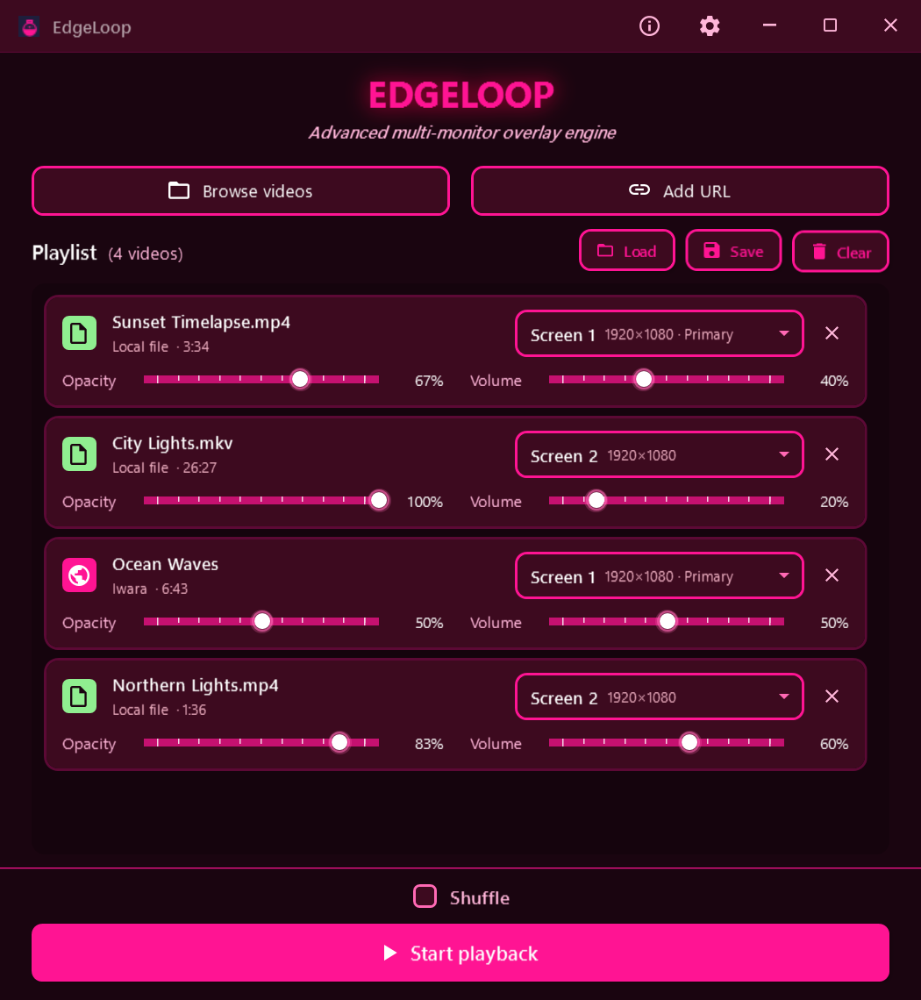

# 🌌 EdgeLoop

**EdgeLoop** is a high-performance video engine designed for multi-monitor setups. Built on a custom fork of `Flyleaf`, it provides seamless, transparent overlays directly on your desktop.

---

## 🚀 Key Features

### 🖥️ Advanced Multi-Monitor Management
*   **Targeted Playback**: Pin videos to specific displays or span them across your entire workspace.
*   **External Synchronization**: Multiple player instances follow a single master clock for frame-exact synchronization across monitors.

### 🔲 Transparent Graphics Pipeline
*   **DirectX 11 Rendering**: Custom pipeline that allows video windows to be truly transparent.
*   **Windowless Feel**: Run content as if it's part of your wallpaper.
*   **Upscaling**: Videos smaller than the screen are enlarged with shaders (AMD FSR 1 or FSRCNNX), on every screen at once and on any graphics card.
*   **HDR**: Turn on **Settings → Playback → HDR on HDR monitors** and HDR videos play in true HDR on monitors that support it. EdgeLoop switches Windows HDR on for those monitors while it plays there and back off afterwards.

### 🌐 Deep Web Integration
*   **Powered by yt-dlp**: Stream from 1000+ sites.
*   **Session Shield**: Safely store and inject cookies to unlock high-res streams.

### ⚡ Performance & Portability
*   **Smart Buffering**: Intelligent disk-caching for high-resolution content.
*   **Zero-Install**: Fully portable architecture. All data is kept in the `Data/` folder.
*   **Panic Mode**: Instant shortcut to wipe all active players from the screen.
*   **Hotkeys that stay out of the way**: Skip keys are only captured while videos play. Skip the screen under the mouse, or give each screen its own keys.

### 💾 Local Caching Architecture
EdgeLoop features a robust background pre-buffering system designed to eliminate stuttering and provide instant seeking capabilities.
*   **MP4/Static Video Sites** (e.g., Iwara, Rule34Video, Hypnotube): EdgeLoop automatically downloads these videos to the local cache (`%LOCALAPPDATA%\EdgeLoop\VideoCache` by default) in the background. When playback starts, it seamlessly switches to the local file for zero-stutter performance.
*   **HLS Streaming Sites** (e.g., PMVHaven): These videos are delivered in live segments and cannot be easily cached as a single file. EdgeLoop streams these directly and bypasses the disk cache.
*   **Auto-Cleanup**: Cached files are automatically cleaned up 10 days after their last access to prevent disk space exhaustion.
*   **Toggle**: You can disable local caching in the Settings if you prefer to stream everything (Note: This may cause slower start times and stuttering when seeking for MP4 sites).

## 🛠️ Technical Stack
*   **Engine**: Custom Flyleaf Fork (C# / WPF / DirectX 11)
*   **Media**: Internal FFmpeg shared libraries
*   **Extraction**: Integrated `yt-dlp`
*   **Platform**: .NET 10 (Windows x64)

## 📦 Installation & Setup

1.  **Requirements**: Ensure the [.NET 10 Desktop Runtime](https://dotnet.microsoft.com/download/dotnet/10.0-windows-desktop-runtime) is installed.
2.  **Download**: Purchase and download the latest bundle from [itch.io](https://psi-conaut.itch.io/edgeloop). This is the only official way to purchase the software.
3.  **Run**: Extract and launch `EdgeLoop.exe`.

### Site Authentication
**Iwara** shows explicit videos only to signed-in accounts. Enter your Iwara email and password in **Settings → Privacy & Cookies** and click **Check sign-in**.

**Hypnotube** (720p for signed-in accounts) and **Rule34Video**: enter your account in **Settings → Privacy & Cookies** (Hypnotube wants your username, not your email) and click **Check sign-in**. EdgeLoop signs in by itself, keeps the session, and signs in again when it runs out.

If a site starts asking for a captcha, EdgeLoop can't answer it and says so. Paste the site's cookies instead:
1.  In your browser, open the site while signed in, press `F12` and choose the **Network** tab.
2.  Reload the page (`F5`), then right-click the first request in the list (the page itself).
3.  Choose **Copy Value → Copy as cURL** (Firefox) or **Copy → Copy as cURL** (Chrome, Edge).
4.  In EdgeLoop, open **Settings → Privacy & Cookies**, click **Paste** next to the site, then **Save**.

**Paste** also accepts a `cookies.txt` file, an extension's JSON export, Chrome's "Copy as PowerShell", the `Cookie` header on its own, or just the `PHPSESSID` value. It keeps only that site's cookies and says what it found. Copy from the Network tab, not the Console: the cookie that signs you in (`PHPSESSID`) is hidden from page scripts, so `document.cookie` leaves it out. EdgeLoop warns you if the pasted cookies don't include it.

Cookies and the Iwara password are stored encrypted for your Windows account. Cookies are shown hidden unless you tick **Show**.

## 🤝 Contributing
*   See [CONTRIBUTING.md](.github/CONTRIBUTING.md) for guidelines.
*   Check the [Roadmap](docs/Flyleaf_Fork_Roadmap.md) for planned features.

## 📜 License
Distributed under the **GPL-3.0 License**. See `LICENSE` for more information.

Upscaling uses shader effects from [Magpie](https://github.com/Blinue/Magpie) (GPL-3.0): FSRCNNX by igv (GPL-3.0), AMD FidelityFX FSR 1 (MIT) and igv's SSimDownscaler (LGPL-3.0). See `FlyleafLib/FlyleafLib/MediaFramework/MediaRenderer/Effects/Magpie/README.md`.

---
*Support the development on [Patreon](https://www.patreon.com/cw/vexfromdestiny) or [Ko-fi](https://ko-fi.com/vexfromdestiny)*
